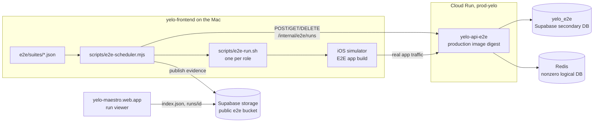

Mobile E2E drives the real iOS app on simulators against an isolated copy of the production API. Every test owns a throwaway fixture of synthetic users, created and deleted through an authenticated control API. This page covers each piece in depth. [Testing](/engineering/testing#mobile-e2e) has the short version, and the [E2E environment reset](/runbooks/e2e-environment-reset) runbook covers recovery.



## The E2E API

The `yelo-api-e2e` Cloud Run service runs the exact image digest currently serving production. `release-e2e.yml` keeps it converged: see [Deployment](/engineering/deployment#e2e-api-convergence). `cloudbuild.e2e.yaml` never rebuilds the API. It builds only a matching migration image, migrates `yelo_e2e`, and deploys the production digest.

### Startup safety checks

The process refuses to start in E2E mode unless every check in `Config.validateE2E` (`internal/utilities/config/config.go`) passes.

| Check | Rule |
| --- | --- |
| Mode | `E2E_ENABLED=true` and `ENVIRONMENT=e2e` must be set together |
| Required values | `DSN`, `KEY`, `E2E_CONTROL_API_KEY`, `E2E_DATABASE_NAME`, `E2E_DATABASE_PROJECT_REF`, `E2E_PRODUCTION_DATABASE_PROJECT_REF` |
| Control key | At least 32 bytes |
| Background jobs | `E2E_BACKGROUND_JOBS_ENABLED` must be false |
| Fixture TTL | `E2E_FIXTURE_TTL` greater than zero and at most 24 hours (default 30 minutes) |
| Database | `DSN` must be a PostgreSQL URL whose database name equals `E2E_DATABASE_NAME`, whose Supabase project ref equals `E2E_DATABASE_PROJECT_REF`, and differs from the production ref. Both `db.<ref>.supabase.co` and pooler usernames are parsed. One local exception: `E2E_DATABASE_PROJECT_REF=local` is accepted when the `DSN` host is a loopback IP literal, the database name starts with `yelo_e2e_`, and the URL has no `host` or `hostaddr` query parameter (`localE2EDatabase`). |
| Redis | Enabled, `redis://` or `rediss://`, and a logical database of 1 or higher |
| Stripe | `STRIPE_API_KEY` starts with `sk_test_` and `STRIPE_PUBLISHABLE_KEY` starts with `pk_test_` |
| Integrations | `CONTACT_SYNC_RESEND_ENABLED` and `GOOGLE_PLAY_RELEASE_MONITORING_ENABLED` false. Twilio, Resend, Photon, Quo, Dub, Slack webhook, and Google or Apple Auth v3 credentials must all be unset. In E2E mode the API uses `dub.Fake` instead of the Dub client, which answers every link write with the short link Dub would have minted, so referral, fleet, event, and tip flows don't fail. |
| Auth v3 | See [Test, E2E, and internal auth paths](/engineering/identity/test-and-internal-auth#e2e-mode) |

`cmd/api/main.go` skips River UI and mutating background tasks while E2E is enabled. When `RIVER_WORKERS_ENABLED=true`, it starts the River client restricted to ride commands: `registerRideOperations` in `internal/notify/queue/queue.go` replaces the queue map with `ride_operations` alone and the periodic jobs with `ride_operation_recovery` alone, and startup logs "E2E mode: isolated ride command workers enabled". With those workers enabled, ride accepts, completions, cancellations, and tips finish their ride board and driver queue effects in E2E. Notification jobs are still inserted, and no worker consumes them. Ride expiry, auto-queue tickers, and push delivery don't run on their own. The fixture API invokes the few production commands a test needs, such as `CancelUnmatchedRides`.

### Deployed configuration

`cloudbuild.e2e.yaml` sets these on the service. Secrets come from Secret Manager with the `yelo-e2e-` prefix.

| Setting | Value |
| --- | --- |
| Environment | `ENVIRONMENT=e2e`, `E2E_ENABLED=true`, `E2E_BACKGROUND_JOBS_ENABLED=false`, `E2E_DATABASE_NAME=yelo_e2e` |
| Scaling | `--min-instances=0`, `--max-instances=2`, `--concurrency=20`. The runner wakes the service before creating fixtures. |
| Observability | `OTEL_ENABLED=false`, `PPROF_ENABLED=false`, `SWAGGER_ENABLED=false` |
| Auth v3 origin | `AUTH_V3_PUBLIC_WEB_ORIGIN` and `AUTH_V3_CORS_ORIGINS` are `https://yelo-maestro.web.app` |
| Redirect allowlist | `yelo-ios` and `yelo-android`, each only `com.rideyelo.e2e://auth/v3/callback` |
| Secrets | `DSN`, `KEY`, `REDIS_URL`, `E2E_CONTROL_API_KEY`, `STRIPE_API_KEY`, `STRIPE_PUBLISHABLE_KEY`, `GOOGLE_MAPS_API_KEY`, `MAPBOX_API_KEY`, and the five `AUTH_V3_*` key secrets |

### Runtime isolation

`E2E_ENABLED=true` selects the account-read and external-provider policy in the
API composition root; cloud deployment does not need separate cache or image
warming flags. Auth status and user profiles read PostgreSQL directly, so fixture
creation/deletion cannot reuse cached account state. Redis stays enabled in the
existing isolated logical database for rate limits, presence, queues and fixture
coordination. Production retains its normal account caches; cache regressions
remain covered by their dedicated tests.

Dub uses its stateless fake and referral image warming is disabled. Fake links
must not fetch production OG image URLs or receive production signing secrets.
Live StudID is rejected at startup in E2E, and school email/OAuth verification
services are not wired; education tests use owned fixtures.
Existing restrictions on messaging, OAuth credentials and Stripe test keys still
apply. `RIVER_WORKERS_ENABLED=true` remains explicit in the cloud deployment;
local processes leave workers off unless deliberately enabled.

The HTTPS StudID callback bridge is absent in E2E. It is a production integration
that forwards only a verification ID to the production app URI.
No database migrations, backfills or new E2E environment settings are required.


## Database and baseline seed

`yelo_e2e` is a secondary database in the Yelo development Supabase project. Schema comes only from API migrations. Business data comes only from the fixture API, which deletes it after each test.

The migration job runs `scripts/release/run-migrations.sh` with `E2E_BOOTSTRAP_SUPABASE_SECONDARY_DATABASE=true`. After `migrate up`, the script applies `scripts/release/seed-e2e-baseline.sql`, which the migration image copies to `/usr/local/share/yelo/seed-e2e-baseline.sql`.

The seed is deliberately tiny. It upserts one row in `VehicleTypes`: slug `x`, display name `YeloX`, 1 to 4 seats, active, with `metadata = {"e2e": true}`. It then raises an exception if that row isn't present and active. The API needs an active vehicle type registry at startup, and every fixture fleet uses type `x`.

<Warning>
Don't add scenario rows to the seed. Rows that no run owns leak across tests and never get cleaned up. Extend the fixture API instead.
</Warning>

`E2ERuns` records every fixture. Its `scenario` column has a `CHECK` constraint, extended by migrations `000337_e2e_confirmed_ride`, `000341_e2e_queued_pair`, and `000342_e2e_notification_rider`. Migration `000336_e2e_fixture_school_identity` backfills `is_synthetic = true` on schools referenced by `E2ERuns.school_id`.

## Fixture API

`internal/server/http/router.go` mounts the group at `/internal/e2e` only when `E2E.Enabled` is true, behind `getE2EKeyMiddleware`. Every request needs the header `X-E2e-Key` with the control key. The handlers live in `internal/server/http/e2econtrol`.

| Method and path | Operation ID | Purpose |
| --- | --- | --- |
| `POST /internal/e2e/runs` | `e2e.CreateRun` | Sweep expired runs, then create or return a fixture |
| `GET /internal/e2e/runs/{id}` | `e2e.GetRun` | Read run state, actors, fixtures, and the owned ride |
| `POST /internal/e2e/runs/{id}/ride-transition` | `e2e.TransitionRide` | Advance a ride fixture through a production command |
| `POST /internal/e2e/runs/{id}/benchmark-presence` | `e2e.RefreshBenchmarkPresence` | Put a benchmark run's fixture drivers back online and return how many |
| `POST /internal/e2e/runs/{id}/payment-fault` | `e2e.PaymentFault` | Arm or release a Stripe fault on a paid fixture. `kind` is `tip_create_loss`, `tip_confirm_loss`, or `tip_receipt_failure`, with `release` to clear it |
| `POST /internal/e2e/runs/{id}/response-fault` | `e2e.ResponseFault` | `action` `arm`, `inspect`, or `release` for `surface` `status` or `details`. Captures a real response and replays it stale to the same rider and ride |
| `GET /internal/e2e/runs/{id}/provider-observation` | `e2e.ObserveProvider` | Read Stripe aggregates for the run: tip intents, tip charges, tip cents, payout cents, and fare callbacks |
| `POST /internal/e2e/runs/{id}/replay-fare-success` | `e2e.ReplayFareSuccess` | Replay the fare success callback for the run's captured fare and return the same aggregates, to prove a duplicate callback doesn't change the payout |
| `GET /internal/e2e/runs/{id}/rider-responses` | none | For an `auth_existing_rider` run, call six production GET handlers in process as the rider (`/community/current`, `/community/feed`, `/map/community`, `/map/friends`, `/user/friends`, `/user/likes`) and return statuses, counts, and body hashes, never bodies |
| `GET /internal/e2e/runs/{id}/signup-prerequisites` | none | The same observer for `/user/current-user`, `/community/current`, `/vehicle/`, `/user/status`, and `/vehicle-types` |
| `DELETE /internal/e2e/runs/{id}` | `e2e.DeleteRun` | Delete everything the run owns |

### Create a run

The request body is `{"scenario": "...", "idempotency_key": "..."}`. The key is required and at most 200 characters. A repeated key returns the existing run instead of creating a new one.

An optional `payment_fixture` turns a `ride_confirmed_rider` run into a paid ride. Values are `cancel_hold`, `cancel_fee`, `buffered_tip`, `late_tip`, `late_tip_auth`, and `review_tip_auth`. It is rejected with any other scenario or with `benchmark`. The run gets a driver and its own Stripe test customer, connected account, saved card, and manual authorization on a $12 fare. Setup progress is stored in `E2ERuns.metadata`. The response adds `payment_ready`. While Stripe is still verifying the test account it is `false`, so repeat the same request until it is `true` before you start the device. See [Paid ride fixture contracts](#paid-ride-fixture-contracts).

An optional `benchmark` object (`fleets` 1 to 6, `drivers_per_fleet` 0 to 10, `pricing_tiers` 1 to 8, `varied_pricing`) is accepted only with `auth_existing_rider`. It adds fleets, online drivers, and tiered pricing to the run's community for the [ride replay benchmark](/engineering/qa/ride-replay-benchmark#what-the-benchmark-replays). Deleting the run also removes the extra fleets and drivers.

Before it creates anything, `Create` cleans up to 100 `active` runs whose `expires_at` has passed and marks them `expired`. A sweep failure is only logged.

Creation runs in one transaction. Every scenario gets:

| Row | Values |
| --- | --- |
| `Communities` | Named `E2E <run prefix>`, bounds 37.30 to 37.40 latitude and -122.10 to -121.90 longitude, `is_active`, `is_test`, primary fleet set, primary vehicle type `x` |
| `Fleets` | `E2E Fleet <run prefix>`, `owner_operator`, `stripe_status = 'not_required'`, type `x` |
| `Schools` | `is_synthetic = true`, extension `e2e.invalid` |
| `RidePriceParameters` and one `RidePriceTiers` row | `per_ride`, base $3.00, $0.50 per minute, $2.00 per mile, featured |
| Rider in `Users` | `E2E Rider`, `rider-<run id>@e2e.invalid`, verified, terms agreed, `is_test`, `profile_completed`, `account_type = 'student'`, graduation year 2030, referral code `e2er<28 hex>` |

Pair scenarios add a driver: `E2E Driver`, with a complete and active `DriverApplications` row, a 2025 Yelo E2E `Vehicles` row of type `x` with plate `E2E<4 hex>` in CA, and `FleetDrivers` and `FleetVehicles` rows.

Phones are deterministic: `+1555` plus seven digits from an FNV-32a hash of the run ID and role (`testPhoneForRole`). The response returns `run_id`, `api_revision`, `scenario`, `status`, `created_at`, `expires_at`, `actors.rider`, `actors.driver` when present, and `fixtures` (`community_id`, `school_id`, `fleet_id`, `vehicle_id`).

### Paid ride fixture contracts

The isolated control plane accepts `payment_fixture` with
`scenario=ride_confirmed_rider`: `cancel_hold`, `cancel_fee`, `buffered_tip`, or
`late_tip`. Startup still requires an isolated database, Redis namespace and
Stripe test keys. No production routes, schema migrations, or new environment
variables are introduced.

Each run owns its Stripe test customer, Custom connected account, saved card,
connected clone and manual authorization. Resource attempts and receipts are
persisted privately in `E2ERuns.metadata`; creation keys include the run and step.
Setup resumes after response loss within a 23-hour creation window. Unknown
creation outside that window preserves the run for reconciliation. Session
advisory locks serialize setup and deletion without consuming the query pool.

An account undergoing Stripe test verification returns `payment_ready=false`
on the idempotency-keyed creation response. Repeat the same creation request
until `payment_ready=true` before device execution. Provider errors expose only
type/code classifications, never PaymentIntent bodies or client secrets.

Fixtures use a $12 fare. `cancel_fee` starts at driver waiting and uses the real
75% cancellation policy. `buffered_tip` starts in pending rider rating with the
normal $5 authorization buffer. `late_tip` starts completed with its $12 fare
already captured by setup; that baseline capture is not a runtime journal step.
Fixture setup does not establish device coverage of a missing late-tip UI.

Deletion first requires terminal financial operations and effect receipts.
It resolves unknown customer/account/card creation using the original keys,
deletes the owned connected account and customer, and detaches the platform
card. Stripe does not delete detached PaymentMethod objects. Partial setup
cleanup never completes or creates an authorization. Provider cleanup failure
rolls back database deletion, retaining resource identities for retry. Every
provider deletion checks run ownership; missing resources allow idempotent retry.

### Payment and response recovery controls

Active, prepared payment runs can arm `tip_create_loss`, `tip_confirm_loss`, or
`tip_receipt_failure` through `POST /runs/{id}/payment-fault`. Provider losses
occur after a real successful Stripe response on the run's connected account;
the original command retains its idempotency keys. Confirmation loss also hides
subsequent observations until release. The receipt barrier installs a trigger
only in the isolated E2E database and rejects the actual settlement receipt write
while armed. No production migration or additional environment setting is needed.
Release requires recorded provider boundary hits and never writes settlement.

`GET /runs/{id}/provider-observation` returns only charge counts, cents and payout.
`POST /runs/{id}/replay-fare-success` reads the owned captured fare from Stripe and
calls the production repository success callback twice, asserting payout is
unchanged. This verifies callback ownership, not signed webhook HTTP delivery.

`POST /runs/{id}/response-fault` accepts `arm`, `inspect`, or `release` for `status`
or `details`. It captures a real successful authenticated response and replays it
only to the same reserved rider and exact ride while the handler continues to run.
A hit requires a changed ride-state signature, not a changed timestamp. Snapshots
remain private in fixture metadata and disappear with fixture deletion. These
controls exercise stale HTTP responses, not APNs delivery or the exact production
render-loop trigger. Their evidence never substitutes for runtime-error capture.

Paired UI acceptance uses `prepare_driver_acceptance` to seed the waiting rider
and active driver trip with the offer deferred from the fleet board. After the
real driver finishes native authentication and navigation setup, its retained
checkpoint allows `publish_assignment` to expose that owned free waiting ride
to the run's fleet. Publication does not assign the driver, modify the request
countdown, or invoke payment work. It is idempotent while the ride is waiting;
foreign, paid, assigned, expired or cleaned fixtures are rejected. `observe_accept`
only verifies assignment already committed through the real driver control.

### Owned rider response observation

`GET /internal/e2e/runs/{id}/rider-responses` uses existing disabled-by-default E2E registration, dedicated control-key middleware, and startup isolation rules. Only the run id is accepted, never an actor, URL, credential, or query. A locked active, unexpired `auth_existing_rider` must own a test rider with the deterministic reserved phone and matching test current/home community. Shared run/user/community locks make deletion wait; cleaned or expired runs cannot generate observations.

An unserved in-process Fuego mux executes six fixed GETs using the existing production handlers, error handler, services, serialization, and derived `user` context. No socket, login, JWT issuance/export, fixture mutation, or response fault is involved. Construction happens only in the E2E registration branch. Production GET semantics and caching remain unchanged.

The returned source is `in-process-production-get`. Inner statuses are actual production-handler HTTP statuses, distinct from the observer's outer HTTP 200. Serialized bodies are hashed before reduction. Only run/rider/community/revision joins, timestamps, schema status, explicit collection counts, current-community equality, and spot-null status leave the process. No phone, raw body, error text, or credentials are exposed or stored. Missing/null arrays, absent spot, unsuccessful envelopes, or non-200 statuses fail schema validation. This validates collection and identity shape, not every nonempty item attribute.

No raw-body artifacts or database observation records are required. Reduction happens in memory, so there is no server evidence to purge during existing fixture deletion, and no schema migration or backfill.

This proves successful serialized backend responses in a control-plane-authorized owned-rider context. It does not intercept device axios requests or prove every app request succeeded. Samples corroborate real UI guards. The normal `/map/community` cache remains active. `/user/friends` deliberately maps reachable-lookup failures to `[]`; observation proves its public serialized contract, not success of that best-effort subquery.

The coupled frontend harness declares the six-GET requirement only for the combined map/social variant. Its real unconfigured Dub QR error remains a separate positive UI assertion, not a backend-empty claim.

Deploy the matching API and frontend harness to the isolated E2E environment. Source tests alone do not establish deployed revision or live coverage.

### Owned signup prerequisites

`GET /internal/e2e/runs/{id}/signup-prerequisites` shares the rider observer's
control-key authorization, fixture TTL, reserved actor checks, and run/user/community
`FOR SHARE` locks. It accepts only a run ID for `auth_existing_rider` and reads
`/user/current-user`, `/community/current`, `/vehicle/`, `/user/status`, and
`/vehicle-types` through the real production GET handlers with the owned actor
context. It returns hashes, statuses, schema validity, identity equality, vehicle
and queue counts, no-active-ride and vehicle-null flags, and active type seat fields.
Missing/error schemas fail closed; valid present vehicles/rides remain distinguishable
from valid empty results. Production legacy status explicitly serializes an empty
queue as null; a missing queue is invalid.

Vehicle types are global active configuration read under the matching owned
community context, not per-community configuration. Their `max_seats` is rider
capacity, not the signup picker's ceiling. No profile bodies, phones, actor tokens,
or raw errors are returned. This is handler response proof, not device Axios
success, request pinning, or a statement that the global database is empty.

### Offline fleet vehicle picker fixture

`POST /internal/e2e/runs` accepts optional `fleet_fixture` only with
`scenario=auth_rider_driver_pair`, without `actor_preset`, `benchmark` or
`payment_fixture`:

```json
{"scenario":"auth_rider_driver_pair","idempotency_key":"capture-fleet-picker-unique-run","fleet_fixture":"fleet_managed"}
```

`fleet_managed` is the only accepted value. Omission retains the original
owner-operator fixture. Unknown values and unsupported combinations are input
errors. The existing `Run` response supplies the reserved `actors.driver.phone`
and owned `fixtures.fleet_id` / `fixtures.vehicle_id`; no app fields or session
tokens are added. The mode is retained in run metadata: idempotent retries must
keep the scenario and mode, including after cleanup, and never reset device
mutations.

This fixture uses production `payment_model=fleet_merchant`,
`has_owner_operators=false`, `has_custom_payouts=true`, an active driver membership,
and an approved default fleet-owned vehicle (`Vehicles.driver_id=NULL`). The
original driver selects that vehicle and remains approved, offline and idle.
Its payout source is the owned fleet with `stripe_status=pending` and no connected
account; personal Stripe is also pending. No Stripe resources are created or
fabricated. Production driver status exposes that active fleet and no current
ride; the vehicle list exposes one selected `Yelo E2E` vehicle with the fleet ID,
default flag, approved status and no occupancy by another driver.

After real native phone authentication and required permissions/navigation,
use the real first-drive promo tile (zero drives, offline) in the Driver Profile
to open `Ready to drive?`. The main Go Online button is disabled because the
production signup contract reports pending payouts. In the confirmation sheet,
the fleet's real vehicle tile is enabled with a chevron. Opening it supports the
`Select vehicle` sheet and its one current vehicle row while offline. This fixture
proves neither an alternate-vehicle switch nor online/ride coverage. Fleet payout
readiness is false and the
production go-online repository rejects the driver; do not continue an online
journey. No readiness flag is fabricated in the fixture response.

The existing isolated E2E startup checks and auth configuration apply. Adoption
requires an API binary containing this option; the running old binary must not be
treated as supporting it. No schema migration, backfill, native dependency or new
configuration is required. Existing run deletion and expiry cleanup remove the
owned membership, fleet mapping, vehicle, driver application, actors and fleet.
The integration test uses a disposable migrated testcontainer to verify ownership,
default compatibility, production status/vehicle/application contracts, offline
selection and online rejection, retry preservation and isolated repeated deletion.

### Stored education proof fixtures

`POST /internal/e2e/runs` accepts optional `education_fixture` with only
`scenario=auth_existing_rider`, without `actor_preset`, `fleet_fixture`,
`payment_fixture` or `benchmark`:

```json
{"scenario":"auth_existing_rider","idempotency_key":"capture-education-unique-run","education_fixture":"email_otp"}
```

`email_otp` seeds one recorded school-email proof; `multiple_proofs` seeds school
email and Google proofs. Omission preserves successful empty connections and
existing actor defaults. These are synthetic preexisting records in the owned
school and rider, not email delivery, OAuth, StudID authorization or verification
completion. No provider calls or login identities are created.

After real native phone authentication, production
`GET /authv3/user/student/connections` returns the actual proof IDs, provider,
owned school name/ID, synthetic `education-<run-id>@e2e.invalid` email,
student affiliation and verified timestamp. Subject fields remain private.
The real Accounts controls can inspect and disconnect a proof through
`DELETE /authv3/user/student/connections/{provider}`. Removing email from the
multiple-proof mode preserves Google. Existing student status is preserved by
the production disconnect contract.

The mode is stored in run metadata and forms part of idempotency identity.
Retries read current state: they never restore disconnected proofs. Changed,
omitted or unsupported modes reject reuse; cleaned/expired run retries never
recreate actors or proofs. Existing deletion and expiry cleanup remove proofs
through owned-user cascading before deleting the owned school, leaving other
runs intact. No migrations, external configuration or provider credentials are
required. This option requires a new local API binary; an already running older
binary does not support it.

### Terminal free ride history fixture

`POST /internal/e2e/runs` accepts optional `history_fixture=terminal_free` only
with `scenario=auth_rider_driver_pair`. It cannot be combined with actor,
education, fleet, payment or benchmark options:

```json
{"scenario":"auth_rider_driver_pair","idempotency_key":"capture-terminal-history-unique-run","history_fixture":"terminal_free"}
```

The response returns backend-validated identities in
`fixtures.history_ride_ids.completed` and
`fixtures.history_ride_ids.rider_canceled_after_match`. `run.ride` remains absent;
these terminal records do not replace or create an active ride. Both belong to
this run's original reserved rider, driver, community, fleet and vehicle. The
newer canceled record appears before the completed record in production rider
and driver history. Select details by these exact IDs, not by an arbitrary row.

Both rides have zero price and payout, disabled tips, and no payment or tip
intent. The completed record has pickup/completion times and an existing rider
rating. The canceled record retains its assigned driver, has no pickup time and
uses production rider cancellation semantics: `status=complete`,
`cancel_phase=driver_waiting`, `cancel_user=rider`. History DTOs do not expose a
canceled badge; do not infer cancellation from a screenshot. This fixture does
not prove live matching, completion, cancellation, review submission or payment
journeys. No payment method brand is fabricated; the current detail UI may show
its ordinary Card fallback for absent payment metadata.

The mode is part of idempotency identity. Retries read the same exact records;
changed or omitted mode rejects reuse. Cleaned/expired retries never recreate
rides or actors. Common cleanup validates a bounded two-UUID metadata array and
exact original actor/community/fleet/vehicle ownership before selecting either
ride. Foreign IDs, malformed metadata or changed ownership fail closed. Existing
unresolved operation effect guards also apply. Cleanup deletes owned ride
messages, operation records and notification jobs before rides and actors;
other runs survive deletion and expiry. No migrations, external configuration,
provider calls or financial resources are required. The serving local API must
be rebuilt and activated separately before using this option.

### Populated saved places fixture

`POST /internal/e2e/runs` accepts `likes_fixture=populated` only with
`scenario=auth_existing_rider`, exclusive of actor, education, fleet, history,
payment and benchmark options. The response exposes `fixtures.saved_places.cafe`
and `.park`, each containing `location_id`, `yelo_place_id`, `mapbox_id`, `name`,
`address`, coordinates, categories and optional current `like_id`. Consume the
returned snapshots; names, addresses and Mapbox IDs contain the full run UUID.
The initial production liked-place order is park then cafe. No ride or driver
is created, and no session or app state is supplied.

The records are real repository-owned Locations and LikedLocations. Production
GET likes, unlike and re-like preserve canonical place identity. A re-like has
its actual new UUID; an unlike leaves `like_id` absent. Idempotent replay reads
current persisted state and never restores likes. Changed or omitted mode
rejects key reuse. Cleanup and expiry never resurrect cleaned data.

Cleanup validates two bounded deterministic location IDs, two initial like IDs,
the original reserved test actor/community and exact snapshot identity. It
accepts actual heart-created rows only for these two canonical places, with the
original name, Mapbox ID and geometry; provider-derived category/address changes
are allowed. Unexpected original-actor likes, foreign metadata, reassigned seed
rows or changed location ownership fail closed. Cleanup deletes exact current
owned likes before deleting owned locations and users. Another actor's like is
never deleted. Shared canonical PlaceIdentities and aliases remain normal global
catalog data, including identities referenced by other actors.

This fixture proves stored saved-place state and real heart mutation persistence,
not provider enrichment. Opening production POI details can still initiate its
ordinary external enrichment; snapshot content and the real heart remain
available without successful enrichment. No external provider data is seeded.
No migrations or external configuration are required; activate a rebuilt local
API separately before using this option.

### Existing rider onboarding presets

`POST /internal/e2e/runs` accepts optional `actor_preset` only with
`scenario=auth_existing_rider`, without `benchmark` or `payment_fixture`:

```json
{"scenario":"auth_existing_rider","idempotency_key":"capture-profile-unique-run","actor_preset":"incomplete_profile"}
```

The other accepted value is `school_unverified`. Omission preserves all existing
scenario defaults. Unsupported values or combinations return an input error.
The response retains the existing `Run` shape: use `actors.rider.id` and
`actors.rider.phone`. No session token, signup actor, or app state is provided.
The preset is stored in run metadata; retries with the same key must retain the
same scenario and preset, including after cleanup. A retry reads current state
and never resets a profile completed by the device.

Both presets seed the run-owned rider with a verified auth-v3 `phone` identity,
`is_verified=false`, and an empty email. `is_verified` is school/account
verification, not proof of phone ownership. An unverified legacy row without an
identity is excluded by direct candidate matching and can produce a new user;
these presets deliberately represent established auth-v3 phone users. They keep
the run's synthetic school, active/home community, and reserved non-dialable
`+1555` phone. `incomplete_profile` retains the student account type;
`school_unverified` uses the production `community` account type so the profile
offers school verification rather than the durable student badge. `incomplete_profile` additionally sets
`profile_completed=false` and clears both names. `school_unverified` keeps the
completed `E2E Rider` profile. No schema migration or backfill is required.

Drive real native auth v3 controls: authorize with PKCE and the native phone
step, accept the current legal versions, send/verify the returned phone with
OTP `12345`, and exchange the callback. `incomplete_profile` returns
`needs_profile`, blank name prefill, and an onboarding token; onboarding status
and finish-profile operate on the original rider. The FE reaches
`/(auth-v3)/finish-profile`, then permission onboarding when device permissions
require it. `school_unverified` returns `authenticated` and skips finish-profile;
it likewise may show permission onboarding before the app. Both remain school
unverified after phone auth/profile completion. The signed-in profile's real
school-verification controls can reach `/(app)/verify/1-oauth` and its email
entry screen. This is not an automatic school-verification redirect. Live school email, Google/Microsoft, and StudID completion are disabled in E2E.
Use stored education proof fixtures for connection controls. The synthetic
`e2e.invalid` school cannot receive email.

Prerequisites are the existing isolated E2E startup safety checks, migrated
fixture database, dedicated control credential (`X-E2e-Key`), isolated Redis and
configured auth-v3 keys/legal versions, plus an app pointed at that API with the
native E2E auth path. Runtime adoption requires a build containing this change;
fixture requests to an older binary do not establish preset coverage. No new
configuration is required.

Use `DELETE /internal/e2e/runs/{run_id}` with the same control credential. The
existing cleanup owns the original rider and its phone attempts/transactions,
attribution, cascading phone identities, handoff codes and legal acceptances,
as well as its synthetic school/community/fleet/pricing. Repeated deletion is
safe; the expiry sweep uses the same cleanup. The auth integration test verifies
identity retention, both exchange statuses, real profile completion, unchanged
school verification, idempotent retries, and cleanup without touching another
run. It uses `testutils.SetupTestDB` (a disposable migrated testcontainer), never
the running E2E database.

### Original driver personal vehicle inventory

`vehicle_fixture: "personal_owned"` is accepted only for `auth_rider_driver_pair`
and cannot be combined with actor, education, fleet, history, likes, payment or
benchmark presets. Omission preserves the existing fixture. The fixture adds one
original-driver-owned `Vehicles` row without a `FleetVehicles` relation. Existing
`fixtures.vehicle_id`, the driver's active vehicle and the primary fleet-linked
queue vehicle remain unchanged.

`fixtures.personal_vehicle` exposes the exact `vehicle_id`, make/model/color,
year, plate/state, seat count, vehicle type and application status. The added
vehicle is a complete Blue 2024 Toyota Camry, four seats, CA, type `x`, with a
run-derived plate. Production `GET /driver/vehicle` returns both vehicles; the
personal row has no `fleet_id` JSON property and is not active, so the real
personal vehicle Edit control is available. No provider or payment setup is
performed. Opening the editor, checking its original inputs and navigating back
are supported. Submitting backend edits or selecting this vehicle as the active
vehicle is outside this fixture contract: cleanup refuses changed snapshots or
selected/session/ride references rather than discarding those mutations.

The personal vehicle UUID is derived from the full original run UUID and stored
in a bounded, exactly one-item metadata array. Observation and cleanup validate
the active run, both original reserved test phone identities, original test
community, primary driver/vehicle ownership and fleet link, exact personal
snapshot and absence of archive/fleet/default/session/ride/run references. Missing
all personal metadata still detects the deterministic row and fails closed.
Cleanup locks the owned rows and deletes only the exact original personal vehicle
before deleting actors. Foreign references are never removed. Idempotent replay
returns the original current fixture without reseeding; cleanup and expiry share
this bounded contract and cleaned replay cannot recreate the vehicle. No database
migration is required.

### Multi-friend social count capability

The independent `social: {"friends": 1..24}` option creates mutual friends in
`auth_existing_rider` and retains `POST /runs/{id}/social-presence`. It is
exclusive of benchmark, payment, actor, education, fleet, history, likes,
vehicle, paired-friends and UI-created-ride modes. This is distinct from the
original-pair `friends_fixture` contract; neither substitutes for the other.

The integrated count capability derives friend UUIDs from the original run and
index, retains the requested count and exact IDs, rejects changed-count replay,
and validates reserved phone/email identities, original school/community and
friendship ownership before presence writes or cleanup. Missing/tampered
metadata and foreign references fail closed. Scoped deletion runs before the
original actor and community cleanup. Cleaned replay never creates new friends.
The production presence contract and final-two-offline behavior are retained.

Native captures require a new integrated runner/API freeze and actual owned
proof. Existing source-only or miniredis test results are not real Redis/native
coverage. No provider results or route-cache geometry are seeded here.

### Refuse surviving participant references

Before deleting original actors, ride cleanup validates that every surviving
ride involving their rider/driver identities or owned community belongs to the
exact admitted deletion set. Foreign run references also block cleanup. UI
binding applies the same refusal to cross-community rider rides and foreign
rider rides assigned the original driver. No additional ride is admitted or
deleted by this guard. Counted social presence and cleanup validate the original
viewer as well as the friend set, rejecting any unauthored friendship or
ride/run reference. Terminal history with retained IDs but no mode is invalid;
removing both keys cannot silently discard complete rides because they remain
unadmitted and block actor deletion. Cleaned replay retains historical metadata
and does not reseed removed data.

### Scenarios

| Scenario | Actors | Initial state | Supported transitions |
| --- | --- | --- | --- |
| `auth_existing_rider` | Rider | Idle | none |
| `auth_rider_driver_pair` | Rider, driver | Both idle | `prepare_assignment`, `accept`, `prepare_idle_assignment`, `auto_assign`, `prepare_idle_queue`, `recover_idle_queue` |
| `ride_confirmed_rider` | Rider. Rider and driver with `payment_fixture` | One free, unassigned `confirmed` ride from `E2E Pickup` to `E2E Destination`. `metadata.ride_id` records it. With `payment_fixture`, the ride is paid and starts in the state that fixture needs, for example `cancel_fee` at driver waiting and `buffered_tip` at pending rider rating. | none |
| `ride_queued_pair` | Rider, driver, plus a fixture-only `Active Rider` | The driver is online with an open `DriverSessions` row and serves a free `in_progress` ride for the active rider. The main rider's confirmed ride is `queued` to that driver with pickup PIN `1234`. No Redis queue state is written, so the app must rebuild the queue from the database. | none |
| `ride_notification_rider` | Rider | Idle, so the app can request notification permission first | `prepare`, `expire` |

### Ride transitions

`POST /runs/{id}/ride-transition` with `{"action": "..."}`. Each action locks the run row and checks that the run is `active`, unexpired, of the right scenario, and that its actors are `is_test` users in the run's community.

<AccordionGroup>
  <Accordion title="Notification fixture: prepare and expire">
    - `prepare` creates the free confirmed ride and bumps the rider's `ride_state_revision` in the same transaction, so the already-signed-in app sees the new ride.
    - `expire` requires a prepared ride. It sets that ride's `confirm_time` to `RideRequestExpiry` plus one second in the past, only if the ride is still confirmed, unassigned, unpaid, and free. After commit it calls the production `CancelUnmatchedRides`. The production lifecycle and notification transactions do the cancellation.
  </Accordion>
  <Accordion title="Pair fixture: assignment actions">
    - `prepare_assignment` creates a confirmed, unassigned ride for the rider, puts the driver online serving an in-progress ride for a new active rider, and bumps both users' revisions.
    - `prepare_idle_assignment` does the same, then completes the driver's active ride and sets `auto_queue = true`, so the driver is idle and auto-queue eligible.
    - `prepare_idle_queue` also seeds the ride as `queued` and `auto_queued` to the driver's open session, simulating a stranded idle queue.
    - `prepare_driver_acceptance` seeds the same waiting ride as `prepare_assignment` but keeps it off the driver's fleet board, so the real driver can finish sign-in first.
    - `publish_assignment` puts that deferred ride on the run's fleet board. It doesn't assign the driver, and it accepts only a free, confirmed, unassigned ride.
    - `observe_accept` calls no service. It only checks that the ride is already `queued` to this driver, after the real driver accepted it in the app.
    - `accept` calls the production `RideService.AcceptRide` as the driver.
    - `auto_assign` calls `RideService.AutoAssignRide`.
    - `recover_idle_queue` calls `RideService.RecoverIdleQueue`.

    Before a service call, the handler checks that the ride is still free, unpaid, and either confirmed and unassigned or, for `recover_idle_queue`, queued to this driver.
  </Accordion>
</AccordionGroup>

### Cleanup

`DELETE` runs one transaction and is idempotent. An already `cleaned` or `expired` run returns as is. For a run with a `payment_fixture`, cleanup first takes a session advisory lock and resolves any Stripe setup call whose result is unknown. Inside the delete it removes the run's connected account and customer and detaches the card. If a Stripe cleanup call fails, the database delete rolls back so you can retry.

<Steps>
  <Step title="Lock owned rides">
    Selects rides whose ID is in `metadata.ride_id` or `metadata.active_ride_id`, or any `requested` unassigned ride, only where the rider is the run's rider or active rider, the rider is `is_test`, and the community is `is_test`. Unconfirmed drafts created by the real app after setup are included.
  </Step>
  <Step title="Delete ride data">
    Cleanup first checks the fixture rides' ride operations. If any operation isn't `succeeded` or `failed`, or has no row in `RideOperationEffectReceipts`, cleanup fails with "fixture financial operations still require resolution or cache delivery" and deletes nothing. Otherwise it deletes, for those rides only: `notify_orchestrate` and `ride_operation` rows in `river_job`, `RideOperationEffectReceipts`, `RideOperationSteps`, `RideOperations`, `RideEvents`, `RideCancellationQuotes`, `RideNotifications`, `RideMessages`, `RideDeclineReasons`, then `Rides`.
  </Step>
  <Step title="Delete auth and actors">
    The active fixture rider, `AttributionTouches` and `AuthTransactions` found through the actors' `AuthPhoneAttempts`, driver sessions and application, the vehicle, and both users.
  </Step>
  <Step title="Delete shared fixtures">
    The school, `FleetCommunityServiceHistory` and `FleetCommunityServices` for this fleet and community, the fleet, then the community.
  </Step>
  <Step title="Mark the run">
    Sets `status` to `cleaned` (or `expired` from the sweep), sets `cleaned_at`, and nulls every foreign key.
  </Step>
</Steps>

### Add a scenario

<Steps>
  <Step title="Extend the constraint">
    Add a migration that drops and re-adds `E2ERuns_scenario_check` with the new value. Keep the down migration additive so historical rows stay valid.
  </Step>
  <Step title="Extend the handler">
    Add the constant, accept it in `Create`, create its rows inside the create transaction, and record any ride IDs in `metadata`. Make sure cleanup finds every row the scenario or the app can create.
  </Step>
  <Step title="Test it">
    Add a case to `fixtures_integration_test.go` that creates two fixtures side by side and cleans each twice.
  </Step>
  <Step title="Ship it">
    The scenario is usable only after a production release, because the E2E service runs the production image. Then reference it from a suite.
  </Step>
</Steps>

## The E2E app

| Aspect | Value |
| --- | --- |
| Bundle ID | `io.flutterflow.ridedesi.desirider.e2e` |
| EAS profile | `e2e-simulator`: internal distribution, channel `e2e`, EAS environment `preview`, iOS simulator build, Android APK |
| Build env | `EXPO_PUBLIC_APP_ENV=e2e`, `EXPO_PUBLIC_API_URL` set to the E2E Cloud Run URL, `EXPO_PUBLIC_E2E_AUTH_ORIGIN=https://yelo-maestro.web.app`, `EXPO_PUBLIC_DISABLE_ANIMATIONS=true` |
| API guard | `lib/config.ts` throws unless an E2E build's API URL is HTTPS, has no credentials, path, query, or fragment, and isn't the production API |
| Auth | Native Auth v3 screens and the `com.rideyelo.e2e` callback scheme |

## Flows and suites

### Flows

Each `.ad` file in `e2e/flows` is a deterministic agent-device program for one role. The runner injects these variables:

| Variable | Scope |
| --- | --- |
| `APP_ID`, `APP_URL_SCHEME`, `E2E_RUN_ID`, `E2E_ROLE`, `ACTOR_ID`, `ACTOR_PHONE`, `ACTOR_PHONE_DISPLAY`, `RIDER_ID`, `RIDER_PHONE`, `RIDER_PHONE_DISPLAY` | Every role |
| `DRIVER_ID`, `COMMUNITY_ID`, `SCHOOL_ID`, `FLEET_ID`, `VEHICLE_ID` | When the fixture has them |
| `AD_ARTIFACTS` | Evidence directory |

`APP_URL_SCHEME` comes from the built app's `Info.plist`, so deep-link flows such as `${APP_URL_SCHEME}://ride/4-ride` use whatever scheme the binary actually registered.

Every flow signs in through the real screens: `get-started`, `method-phone`, `phone-input`, `continue`, then `otp-input` with `12345`. `auth-existing-actor.ad` then waits for `home-action-bar`, `location-gate-enable`, or `where-to`.

### Suites

A suite is a JSON manifest with `schemaVersion: 1`, a `name`, a list of `tests`, an optional `coverageCatalog`, and an optional `purpose` of `e2e` (the default) or `capture-only`. A capture-only suite exists to screenshot product surfaces for the [product inventory](#product-inventory). It can't declare a `coverageCatalog`, `expectedRide`, or `rideTransitions` (`scripts/e2e-capture-purpose.mjs`).

Each test has a unique `id`, a `scenario`, and one to ten `roles`. Each role has `name`, `actor`, `flow`, and these optional fields:

- `startDelayMs` or `startAfterTransition` to stagger startup.
- `startAfterCheckpoint`: `{role, screenshot}`. The role starts only after another role in the test writes that exact screenshot.
- `locationPermission`: `always`, `foreground`, or `denied`.

`loadSuiteDefinition` in `scripts/e2e-suite.mjs` validates all of this when the suite loads. Tests can also declare:

- `freshDeviceState: true` to erase and reinstall the leased simulators before the fixture is created. Use it when the flow depends on OS state, such as notification permission or URL hand-off approval.
- `rideTransitions`: an ordered list of `{role, action, afterScreenshot, notification}`. The scheduler calls the transition after the role writes `afterScreenshot`. With `notification`, it injects the payload from `e2e/notifications/*.json` into the simulator only after the transition commits. A payload whose `body.ride_id` is the literal `${FIXTURE_RIDE_ID}` is bound first: `bindRideTransitionNotification` replaces it with the committed fixture ride's ID and adds that ride's `status`. `ride-status-changed.json` (`type: ride_status_changed`) is the only payload that uses the placeholder, so the app runs its normal push invalidation against the real ride. `ride-canceled.json` and `ride-confirmed.json` are static tap payloads.
- `expectedRide`: `{status, cancel_phase, cancel_user}`, with exactly those three keys. After the roles finish, the scheduler reads the fixture run, writes `ride-observation.json` beside the roles' evidence, and fails the test unless the ride matches. `validateRideExpectation` in `scripts/e2e-ride-assertions.mjs` rejects outcomes the scenario can't reach when the suite loads.
- `paymentFixture`: `cancel_hold`, `cancel_fee`, `buffered_tip`, `late_tip`, `late_tip_auth`, or `review_tip_auth`. It asks the fixture for a paid ride in that state. It is valid only on `ride_confirmed_rider`, needs both `expectedRide` and `expectedFinancial`, and can't be combined with `rideTransitions`.
- `expectedFinancial`: nonnegative integer assertions on the ride's financial journal, checked with `expectedRide`. It must include `pending_operations`, `quarantined_operations`, `undelivered_operations`, and `unresolved_steps`. It can also set `succeeded_operations`, `min_succeeded_operations`, `failed_operations`, `capture_count`, `captured_cents`, `void_count`, and `dedicated_tip_cents`.
- `paymentFault`: `{kind, role, afterScreenshot}`, where `kind` is `tip_create_loss`, `tip_confirm_loss`, or `tip_receipt_failure`. It is valid only with `paymentFixture: late_tip`. The scheduler arms the fault on the fixture, waits for the role to write `afterScreenshot`, releases it, and writes `payment-fault.json` beside the evidence. The flow then recovers through the real button.
- `responseFault`: `{surface, role, afterScreenshot}`, where `surface` is `status` or `details` and the role is a rider. It needs `rideTransitions`. The fixture captures a real response from before the transition, replays it afterward, and releases only once the app shows the changed state. `response-fault.json` records each step.
- `riderResponses`: `empty-map-social` or `signup-drafts`. It makes the run observe the fixture rider's own API responses (`scripts/e2e-rider-responses.mjs`), so an empty-state capture is backed by what the API returned. It is valid only for a single-rider `auth_existing_rider` test without a `responseFault`, and `signup-drafts` also needs a capture-only suite.

`rideTransitions` entries also accept `notificationRole`, which names the rider role that receives the injected payload. On `auth_rider_driver_pair`, a three-step list of `prepare_driver_acceptance`, `publish_assignment`, and `observe_accept` lets the driver accept on the real request card. `observe_accept` only checks the committed assignment.

| Suite | Tests | Scenarios |
| --- | --- | --- |
| `core-smoke.json` | Cold launch, existing rider auth, rider and driver auth | `auth_existing_rider`, `auth_rider_driver_pair` |
| `ride-recovery.json` | Confirmed ride restart and abort, then cancel | `ride_confirmed_rider` |
| `ride-link-recovery.json` | Six stale and root deep links, warm and cold, confirmed and canceled | `ride_confirmed_rider` |
| `ride-notification-smoke.json` | Canceled tap, auto-expiry tap, queued-assignment tap | `ride_confirmed_rider`, `ride_notification_rider`, `auth_rider_driver_pair` |
| `ride-autoqueue.json` | Idle auto-queue becomes active, stranded queue recovers, arrival across a restart | `auth_rider_driver_pair` |
| `ride-pickup.json` | Arrival, valid PIN, invalid PIN, PIN recovery | `ride_queued_pair` |
| `ride-queue-promotion.json` | Driver completes or cancels, and the queued rider is promoted | `ride_queued_pair` |
| `ride-queued-cancellation.json` | Queued rider cancels while the driver keeps the active ride | `ride_queued_pair` |
| `ride-queued-recovery.json` | Queued cache recovery on restart, legacy link warm and cold | `ride_queued_pair` |
| `ride-driver-requeue.json` | Driver cancels before pickup | `ride_queued_pair` |
| `ride-coordinate-stops.json` | Addressless POI ride options | `auth_existing_rider` |
| `ride-financial-cutover.json` | Nine tests in one run, reusing the test IDs of the recovery, queued-cancellation, queue-promotion, driver-requeue, and auto-queue suites: confirmed restart and abort cancels, queued rider cancel, promotion after the driver completes or cancels, driver cancel before pickup, and the three idle auto-queue cases. Every test sets `expectedRide`. The auto-queue tests inject `ride-status-changed.json` after each transition | `ride_confirmed_rider`, `ride_queued_pair`, `auth_rider_driver_pair` |
| `ride-paid-financial.json` | Three paid rides: cancel and release the hold, cancel while the driver waits and capture the $9 fee, and a buffered tip captured with the fare. Every test sets `paymentFixture` and `expectedFinancial` | `ride_confirmed_rider` |
| `ride-tip-payment.json` | Late tip, tip that needs authentication, authentication retry, and a tip from the review screen that needs authentication | `ride_confirmed_rider` |
| `ride-payment-failure-recovery.json` | A lost tip create response, a lost tip confirm response, and a failed tip receipt write, each through `paymentFault` | `ride_confirmed_rider` |
| `ride-notification-stale-recovery.json` | Auto-expiry with a stale status response, and queued assignment with stale ride details, each through `responseFault` | `ride_notification_rider`, `auth_rider_driver_pair` |
| `ride-driver-acceptance-notification.json` | The driver accepts on the real request card, then the rider taps the assignment notification | `auth_rider_driver_pair` |
| `ride-live-activity.json` | Rider and driver reach `driver_waiting` with the Live Activity showing | `ride_queued_pair` |

`e2e/suites` also holds 16 `product-*.json` suites that capture screens for the [product inventory](#product-inventory). Nine of them are capture-only: `product-driver-hub-inventory`, `product-map-social-inventory`, `product-native-support-personal-inventory`, `product-next-static-inventory`, `product-route-inventory`, `product-school-entry-inventory`, `product-settings-core-inventory`, `product-signup-draft-inventory`, and `product-social-inventory`. The other seven are `product-browse-validation`, `product-capture-expansion`, `product-dense-inventory`, `product-nonride-inventory`, `product-provider-errors`, `product-ride-tools`, and `product-settings-drafts`.

`e2e/suites/ride-notification-regressions.md` is a plan, not a runnable suite.

### Sweeps

A sweep runs several suites through one device queue. Each file in `e2e/sweeps` has `schemaVersion: 1` and a `suites` list of `{path, testIds}`, where `testIds` is optional and selects tests from that suite. `loadSweepDefinition` in `scripts/e2e-sweep.mjs` loads every member with the normal suite validation and rejects two members with the same suite name. Results keep each test's original suite name, so coverage and inventory joins still work.

Set `E2E_SWEEP` to the sweep path when you start `scripts/e2e-scheduler.mjs`, or run the **Mobile E2E** workflow with `mode: sweep`. No Makefile target sets it. To run part of a single suite without a sweep, set `E2E_TEST_IDS` to a comma-separated list of test IDs. The scheduler rejects `E2E_TEST_IDS` together with `E2E_SWEEP`.

`e2e/sweeps/product-inventory.json` is the workflow's default sweep. It runs `core-smoke`, `product-nonride-inventory`, and ten ride suites.

### Product inventory

`e2e/inventory/product.json` is the registry of product surfaces and journeys that the [evidence viewer](#evidence-viewer) joins to captures. `scripts/e2e-inventory.mjs` builds a catalog from the registry, the app's routes, and every suite:

| Target | Command | Result |
| --- | --- | --- |
| `make inventory-check` | `node scripts/e2e-inventory.mjs check` | Validates the registry and that every app route is registered. Prints the surface, flow, and route counts. `make test` and the **Mobile E2E** workflow both run it. |
| `make inventory-export OUTPUT=<path>` | `node scripts/e2e-inventory.mjs export <path>` | Writes the catalog to a file. The default is `.artifacts/e2e/inventory/catalog.json`. |
| `make inventory-publish` | `node scripts/e2e-inventory.mjs publish` | Uploads the catalog to `inventory/catalog.json` in the `e2e` bucket (`E2E_ARTIFACT_BUCKET`). It needs `SUPABASE_URL` and `SUPABASE_SECRET_KEY`, and refuses to run from a checkout with uncommitted changes. |

Each run manifest also gets an `inventoryEvidence` block (`buildInventoryEvidence`, called from `scripts/e2e-artifacts.mjs`), which ties the run's captures to a catalog hash.

### Scheduler

`scripts/e2e-scheduler.mjs` drains a suite with up to `E2E_MAX_DEVICES` simulators (at most 10):

1. It takes a worktree lock at `.expo/e2e-suite.lock`, so only one scheduler runs per worktree.
2. It starts the earliest queued test whose full role set fits. Smaller tests can backfill idle slots, and a large test never starts partially.
3. It creates the fixture, starts one `scripts/e2e-run.sh` per role with its own simulator, agent-device session, and recording, and runs the roles concurrently. Recorder startup is briefly serialized because CoreSimulator rejects bursts.
4. It deletes the fixture, then resets each device: app reinstall, keychain reset, known location and permission grants, and XCTest cleanup.
5. It returns the slots and writes the aggregate manifest.

The scheduler repeats a control-plane request once, and only after a connection timeout (`UND_ERR_CONNECT_TIMEOUT`). That covers `GET` fixture reads and the `POST /internal/e2e/runs` create, which is safe to repeat because it carries an idempotency key. Ride transitions and fixture deletes are never repeated, and neither are device flows or whole tests.

`scripts/e2e-run.sh` launches `node_modules/.bin/agent-device` from the checkout. Set `E2E_AGENT_DEVICE_BIN` to another executable when the device host supplies its own agent-device launcher. Device leases and evidence rules are the same either way.

### Legacy rigs

A rig is the older paired-test format. The scheduler still accepts it, but new tests belong in a suite.

`e2e/rigs/auth-rider-driver.json` is the only rig. It has `schemaVersion: 1`, a `name`, one `scenario` (`auth_rider_driver_pair`), and a `roles` list instead of `tests`. Its two roles both run `e2e/flows/auth-existing-actor.ad`: `driver` with no delay and `rider` with `startDelayMs: 750`.

`loadSuiteDefinition` in `scripts/e2e-suite.mjs` converts a rig into a suite named `<name>-compatibility`. It creates `E2E_PAIRS` copies of the test, with ids `<name>-1`, `<name>-2`, and so on. `E2E_PAIRS` times the role count must fit in `E2E_MAX_DEVICES`, or the load fails. The converter copies only `scenario` and `roles`, so a rig can't carry `rideTransitions`, `freshDeviceState`, or a `coverageCatalog`.

`scripts/e2e-rig.mjs` has no logic of its own. It imports `scripts/e2e-scheduler.mjs`, which reads the definition path from `E2E_SUITE`, then `E2E_RIG`, then its first argument.

| Target | Runs | Prefer |
| --- | --- | --- |
| `make e2e-rig` | `node ./scripts/e2e-rig.mjs` against a supplied app | `make e2e-suite` |
| `make e2e-rig-local` | `./scripts/e2e-local.sh`, which calls `e2e-rig.mjs` when `E2E_RIG` is set and `E2E_SUITE` is not | `make e2e-suite-local` |
| `make e2e-rig-publish` | The local run with `E2E_PUBLISH=1` | `make e2e-suite-publish` |

All three default `RIG` to `e2e/rigs/auth-rider-driver.json` and `PAIRS` to `1`. They don't pass `MAX_DEVICES`, so the scheduler default of 8 applies.

`agent-device.json` at the repo root is a separate two-key file: `platform: "ios"` and `snapshotDepth: 8`. No script, Makefile target, or workflow in the repo references it by name. The runner passes `--platform ios` on its own `agent-device` calls.

### Evidence

Each run writes `.artifacts/e2e/<run-id>/`, with roles under `scenarios/<index>-<test-id>/<role>/`. A run passes only with an MP4, at least one PNG, a non-empty timeline, JUnit XML, and a manifest. Missing evidence, a failed fixture, a failed role, or a failed cleanup fails the scenario and the aggregate.

A suite with `coverageCatalog` (such as `e2e/coverage/ride-workflows.json`) also gets `workflow-coverage.json`. Each mapped catalog case names one `workflow.suite` and `workflow.testId`. An optional `workflow.additionalSuites` list names other suites whose run of the same test ID also counts for the case. `ride-workflows.json` uses it to map 12 cases to `ride-financial-cutover`. `scripts/e2e-coverage.mjs` rejects a value that isn't a list of non-empty strings, and suite loading fails when a mapped suite lacks the test. A case counts as verified only when its mapped test passed, every role ran exactly once with complete evidence, and the reported app and API revisions match. Local builds write `<archive>.provenance.json` with source and bundle hashes. Runs on archives without provenance can't earn coverage credit.

## Evidence viewer

The `maestro` site in `yelo-web` (`src/sites/maestro`) is the viewer, deployed to `https://yelo-maestro.web.app`. The hostname is historical: no Maestro runs anywhere.

- The default view is the product inventory (`ProductInventory.tsx`): app screens, states, and flows joined to captures from these runs. `?view=screens` and `?view=flows` select its two sections. `?view=previews` opens a gallery of the `og` Worker's link-preview cards, which doesn't use run data. The dashboard embeds the same viewer at `/inventory` for admins. See [Inventory](/dashboard/inventory) and [Public sites](/engineering/web/public-sites#maestro).
- `?view=runs` lists runs from `<ARTIFACT_ROOT>/index.json` with **all**, **failed**, and **passed** filters. Pins are stored in `localStorage` under `e2e-report:pins`.
- `?run=<run-id>` opens `RunViewer`, which loads `<ARTIFACT_ROOT>/runs/<run-id>/` and shows each test and role's recording beside a searchable action log that seeks the video. `&execution=<testId>:<role>` selects a role and `&t=<seconds>` seeks. For a role with its own `manifestPath`, the viewer loads that manifest so timeline offsets use the role's `startedAt`. Without a `replay-timing.ndjson`, the action log falls back to the projected public timeline events (`timelineEvidenceEntries()`), which carry no raw messages or hints. Failed executions show **Execution failed**, plus `replay-failed` when a test failed with that message.
- The inventory reads its catalog from `<ARTIFACT_ROOT>/inventory/catalog.json` and falls back to the `product-catalog.json` bundled with the viewer. `make inventory-publish` in `yelo-frontend` writes that object by hand. No workflow publishes it. See [Product inventory](#product-inventory).
- `WorkflowCoverage.tsx` shows mapped and verified percentages.
- `ARTIFACT_ROOT` is `VITE_E2E_ARTIFACT_BASE_URL` when set, otherwise `<VITE_SUPABASE_URL>/storage/v1/object/public/e2e`.
- The site also serves `/auth/v3`, a copy of the hosted Auth v3 page built against `VITE_E2E_API_URL` with the `com.rideyelo.e2e` scheme. Its `firebase.json` sets `no-store` and a strict CSP for that path. See [Sites](/engineering/web/sites#maestro).

The bucket is public. Publish only synthetic runs.

## Test accounts

There are no persistent E2E accounts. Each test gets new actors from its fixture:

- Phone `+1555` plus seven digits, derived from the run ID and role. Enter it through the real phone screen. `ACTOR_PHONE_DISPLAY` holds the formatted value.
- OTP `12345`. Twilio is never called for `+1555` numbers. See [Test, E2E, and internal auth paths](/engineering/identity/test-and-internal-auth#reserved-phone-numbers).
- Drivers arrive approved, active, in a fleet, and with a vehicle. Tests never walk driver onboarding.
- Auth v3 rate limits are multiplied by 100 in E2E mode, so parallel sign-ins don't trip them.

## Run it

<Tabs>
  <Tab title="Locally">
    Prerequisites: Xcode with an iOS runtime, `jq`, `ffmpeg`, `pnpm install`, Expo login for a new build, and a `gcloud` identity that can read `yelo-e2e-control-api-key` in `prod-yelo`.

    ```bash
    make e2e-doctor
    make pool-status
    make e2e-build-local
    make e2e-local FLOW=e2e/flows/auth-existing-actor.ad

    # One driver flow against a pair fixture
    E2E_SCENARIO=auth_rider_driver_pair E2E_ACTOR_ROLE=driver E2E_ROLE=driver \
      make e2e-local FLOW=e2e/flows/my-driver-flow.ad

    make e2e-suite-local SUITE=e2e/suites/ride-pickup.json MAX_DEVICES=4
    make e2e-signoff SUITE=e2e/suites/core-smoke.json MAX_DEVICES=8
    ```

    | Variable | Effect |
    | --- | --- |
    | `E2E_APP_PATH` | Use this `.app` instead of building |
    | `E2E_AUTO_BUILD=0` | Don't build. Use with a supplied archive. |
    | `E2E_BUILD_PROVENANCE` | Provenance record for a supplied `.app` |
    | `E2E_OPEN_SIMULATOR=1` | Show the simulators |
    | `E2E_KEEP_DEVICES_BOOTED=1` | Leave simulators booted for debugging |
    | `E2E_SKIP_INSTALL=1` | Skip install. Still requires `E2E_APP_PATH` when a fixture is used. |

    Clean builds are cached by Git SHA under `~/.cache/yelo-e2e-builds`. Edits limited to flows, suites, runner scripts, and E2E docs can reuse a cached ancestor. App changes force an exact build.
  </Tab>
  <Tab title="GitHub Actions">
    **Mobile E2E** (`e2e-agent-device.yml`) is manual only and never a merge gate. It shares one concurrency group, `mobile-e2e-publish`, and doesn't cancel in-progress runs.

    | Input | Options | Default |
    | --- | --- | --- |
    | `runner` | `self-hosted`, `github-hosted` (paid) | `self-hosted` |
    | `app_source` | `local`, `eas` | `local` |
    | `app_url` | EAS simulator archive URL | blank: build the commit |
    | `mode` | `flow`, `schedule`, `sweep` | `schedule` |
    | `flow` | Flow file or directory | `e2e/flows` |
    | `suite` | Suite path, for `schedule` mode | `e2e/suites/core-smoke.json` |
    | `sweep` | Sweep path, for `sweep` mode. See [Sweeps](#sweeps). | `e2e/sweeps/product-inventory.json` |
    | `max_devices` | 1 to 10 | 8 |
    | `fresh_runner` | Boolean. A self-hosted diagnostic that builds a private XCTest runner. | `false` |

    ```bash
    gh workflow run e2e-agent-device.yml --repo rideyelo/yelo-frontend --ref main \
      -f runner=self-hosted -f app_source=local -f mode=schedule \
      -f suite=e2e/suites/core-smoke.json -f max_devices=8
    ```

    The self-hosted runner has labels `self-hosted`, `macOS`, `ARM64`, and `yelo-e2e`. Run one runner process only. The job runs `make inventory-check` before it schedules anything. Artifacts upload as `e2e-<github-run-id>` for 14 days, and private startup diagnostics upload as `e2e-startup-<github-run-id>-<attempt>` for 7 days.

    Repository configuration: variables `E2E_API_URL`, `E2E_ARTIFACT_SUPABASE_URL`, and `E2E_VIEWER_URL`, and secrets `EXPO_TOKEN`, `E2E_CONTROL_API_KEY`, and `E2E_ARTIFACT_SUPABASE_SECRET_KEY`.
  </Tab>
  <Tab title="Against the API directly">
    ```bash
    curl -sS -X POST -H "X-E2e-Key: $E2E_CONTROL_API_KEY" \
      -H 'Content-Type: application/json' \
      -d '{"scenario":"auth_rider_driver_pair","idempotency_key":"manual-<unique>"}' \
      "$E2E_API_URL/internal/e2e/runs"

    curl -sS -H "X-E2e-Key: $E2E_CONTROL_API_KEY" "$E2E_API_URL/internal/e2e/runs/<run-id>"
    curl -sS -X DELETE -H "X-E2e-Key: $E2E_CONTROL_API_KEY" "$E2E_API_URL/internal/e2e/runs/<run-id>"
    ```

    Delete what you create. An abandoned run is cleaned only by the next `POST` after its TTL.
  </Tab>
</Tabs>

Before you hand off a runner change, run `node --test scripts/e2e-resource-queue.test.mjs` and `make check`. `make test` already runs `make inventory-check` and 25 of the 26 `scripts/e2e-*.test.mjs` suites. It skips `e2e-suite-lock.test.mjs`. See [Mobile tests](/engineering/qa/mobile-tests#script-tests).

## Reset

Follow the [E2E environment reset](/runbooks/e2e-environment-reset) runbook. In short:

| Stuck part | Fix |
| --- | --- |
| Leaked fixture | `DELETE /internal/e2e/runs/{id}`, or wait for the next create after the TTL |
| Simulator leases | `make pool-clean` for dead worktrees, `make pool-reset` for the whole machine |
| Suite lock | Confirm the PID in `.expo/e2e-suite.lock` is dead, then delete the file |
| API drift | `gh workflow run release-e2e.yml --repo rideyelo/yelo-api --ref main` |
| Wrong app | `make e2e-build-local` |

## Authoring rules

- Drive real controls. Don't add test-only UI, session injection, or deep-link authentication.
- Prefer stable `testID`s, then stable text. Use a recorded coordinate only for a real control hidden by native accessibility, and comment why.
- Wait for the next meaningful state instead of sleeping. `startDelayMs` only staggers startup.
- Give `BottomSheetModal` `accessible={false}` so inner `testID`s reach UI Automation. `YeloGlassView` can hide children.
- Capture a success screenshot for every role.
- Keep flow retries at zero (`E2E_RETRIES` defaults to `0`). A flake is a failure to diagnose, and a test that needed more than one attempt earns no coverage credit. The scheduler's single repeat of a timed-out fixture request is separate and doesn't rerun a flow.

## Gotchas and edge cases

- **Workers are off.** The shared E2E API can't test ride expiry, auto-queue, push delivery, or any River job except through a fixture transition. Unreleased workers need an isolated candidate deployment.
- **E2E follows production, including rollbacks.** A new scenario works only after its migration and handler are released. After a rollback across a migration, convergence fails until production is back on the newest version.
- **Idempotency keys are forever.** A repeated key returns the old run, even if it's `cleaned`. Use a unique key per attempt.
- **Assignment transitions on the wrong run return 500.** `transitionAssignment` wraps `pgx.ErrNoRows` in `fmt.Errorf` when the run isn't an active pair (`assignment_transition.go:34`). The expiry path maps the same case to 404.
- **Fixture coordinates are fixed.** Riders are inserted at latitude and longitude 0, drivers at the fixture school (37.3349, -122.0090), and fixture rides run between `1 Test Way` and `2 Test Way` near that point.
- **Check the serving revision.** This guide is the canonical fixture reference. Confirm that the deployed API contains an option before using it; `Handler.Create` and the constraint migrations define the accepted contract.

## Where this lives in code

| Concern | Path |
| --- | --- |
| Config validation | `yelo-api/internal/utilities/config/config.go` (`validateE2E` and helpers) |
| Route mount and key middleware | `yelo-api/internal/server/http/router.go`, `middleware.go` |
| Fixture handlers | `yelo-api/internal/server/http/e2econtrol/routes.go`, `ride_fixture.go`, `queued_fixture.go`, `ride_transition.go`, `assignment_transition.go` |
| Fixture tests | `yelo-api/internal/server/http/e2econtrol/*_integration_test.go` |
| Baseline seed and migration runner | `yelo-api/scripts/release/seed-e2e-baseline.sql`, `run-migrations.sh` |
| Deploy | `yelo-api/cloudbuild.e2e.yaml`, `.github/workflows/release-e2e.yml` |
| Background job switch | `yelo-api/cmd/api/main.go` |
| Flows, suites, sweeps, coverage catalog | `yelo-frontend/e2e/` (`flows/`, `suites/`, `sweeps/`, `coverage/`, `notifications/`) |
| Product inventory | `yelo-frontend/e2e/inventory/product.json`, `scripts/e2e-inventory.mjs` |
| Legacy rig | `yelo-frontend/e2e/rigs/auth-rider-driver.json`, `scripts/e2e-rig.mjs`, `scripts/e2e-suite.mjs` (`loadSuiteDefinition`) |
| Runner | `yelo-frontend/scripts/e2e-*.mjs`, `e2e-run.sh`, `e2e-local.sh` |
| Workflow | `yelo-frontend/.github/workflows/e2e-agent-device.yml` |
| Build profile and API guard | `yelo-frontend/eas.json`, `yelo-frontend/lib/config.ts` |
| Viewer | `yelo-web/src/sites/maestro/` |
