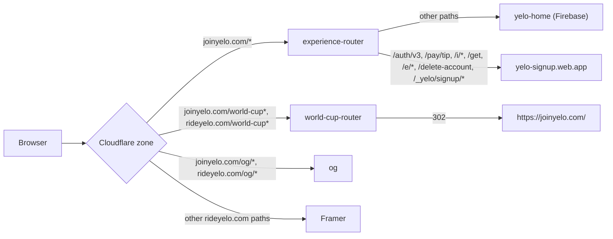

Requests for Yelo web properties pass through up to three layers: a Cloudflare Worker on a marketing domain, Firebase Hosting for the static site, and the API on Cloud Run. This page lists every rule in each layer. For the build that produces the static files, see [Multisite build](/engineering/web/multisite).

## Hostnames referenced in code

| Hostname | Served by | Evidence in code |
| --- | --- | --- |
| `joinyelo.com`, `www.joinyelo.com` | Firebase `home` site, proxied through Cloudflare. `experience-router` runs on every path and proxies the signup-owned ones. The `og` Worker owns `/og/*`. | `home/index.html` `og:url`; `docs/authv3-web-native.md` ("Unmatched requests continue to the Firebase home origin") |
| `rideyelo.com`, `www.rideyelo.com` | Framer, proxied through Cloudflare. Worker routes intercept `/world-cup*` and `/og/*`. | `workers/world-cup-router/README.md` |
| `yelo-signup.web.app` | Firebase `signup` site | `experience-router` `SIGNUP_ORIGIN` |
| `yelo-world-cup.web.app` | Firebase `world-cup` site | `world-cup-router` `WORLD_CUP_ORIGIN` |
| `api.joinyelo.com`, `api.rideyelo.com` | Cloud Run API (both names) | `src/lib/api-client.ts`, `authV3BaseURL.ts`, `JobsPage.tsx`, signup CSP |
| `signup.yelo.link`, `join.yelo.link`, `pay.yelo.link`, `yelo.link` | Short-link hosts. `yelo.link`, `join.yelo.link`, and `pay.yelo.link` are Dub domains. `signup.yelo.link`, `invite.yelo.link`, and `event.yelo.link` only redirect, through Cloudflare rules outside the repository. See [Legacy host redirects](/engineering/web/edge-and-routing#legacy-host-redirects). | `webOAuth.ts`, `EventFormSheet.tsx` (`yelo.link/e/<slug>`), `referralHandoff.ts`, `QRConfigCards.tsx`, `openApp.ts`, the generated `createLinkRequest.ts` |

Firebase Hosting site IDs come from `.firebaserc`: `yelo-dashboard-v2`, `yelo-signup`, `yelo-home`, `yelo-maestro`, and `yelo-world-cup`, all in project `yelo-dashboard-v2`. The `yelo-event` and `yelo-invite` targets were removed with their sites in October 2026.

### Legacy host redirects

These retired hosts redirect through a single-redirect ruleset (`http_request_dynamic_redirect`) on the `yelo.link` Cloudflare zone. It isn't in any repository. Cloudflare evaluates the rules in this order, and the first match wins:

| Host and path | Redirects to |
| --- | --- |
| `event.yelo.link/` | `https://joinyelo.com/` |
| `event.yelo.link/<slug>` | `https://yelo.link/e/<slug>` |
| `invite.yelo.link/` | `https://joinyelo.com/` |
| `invite.yelo.link/i/<code>` | `https://joinyelo.com/i/<code>` |
| `invite.yelo.link/<path>`, including `/fleet/<code>` | `https://joinyelo.com/i/<path>` |
| `drive.yelo.link/*` | `https://joinyelo.com/drive` |
| `events.yelo.link`, `safe.yelo.link`, `content.yelo.link` | `https://joinyelo.com/` |
| `signup.yelo.link/tip` and `/tip/*` | `https://joinyelo.com/pay/tip/*` |
| `signup.yelo.link/<path>` | `https://joinyelo.com/<path>` |

Every hop is a `302`. The DNS records stay in place so the proxied hostnames still resolve. `signup.yelo.link` and `invite.yelo.link` still have CNAMEs to their Firebase sites, but the redirect fires first. `event.yelo.link` points at Dub. The `yelo-event` and `yelo-invite` Hosting sites still exist in project `yelo-dashboard-v2` and return `404`.

To change a redirect, edit the rule in the Cloudflare dashboard under **Rules** > **Redirect Rules** for `yelo.link`, then check it with `curl -sI https://<host>/<path>`.

## Cloudflare Workers

All three Workers set `workers_dev: false` and `preview_urls: false`, enable observability with a head sampling rate of 1, and use `nodejs_compat`. They deploy independently of any site: the **Workers** workflow deploys a worker when its directory changes on `main`, and `pnpm worker:<name>:deploy` still works by hand. See [Cloudflare Workers](/engineering/ci/release-pipelines#cloudflare-workers).

### experience-router

`workers/experience-router/src/index.ts` keeps signup-owned experiences on `joinyelo.com` URLs.

| Route pattern (`wrangler.jsonc`) | Zone |
| --- | --- |
| `joinyelo.com/*`, `www.joinyelo.com/*` | `joinyelo.com` |

The Worker runs for every request on `joinyelo.com`, except the paths that `world-cup-router`'s longer `/world-cup*` pattern owns. It then classifies the exact path:

| Public path | Experience | Upstream request | `X-Yelo-Proxy` |
| --- | --- | --- | --- |
| `/auth/v3` or `/auth/v3/` | `auth-v3` | `SIGNUP_ORIGIN/auth/v3/` (always the trailing-slash form) | `experience-auth-v3` |
| `/pay/tip` or `/pay/tip/<rest>` | `tip` | `SIGNUP_ORIGIN/tip/<rest>` | `experience-tip` |
| `/i/<code>` (anything longer than `/i/`) | `invite` | `SIGNUP_ORIGIN/i/<code>` (same path, so attribution cookies are first-party to the `joinyelo.com` sign-up page) | `experience-invite` |
| `/get` or `/get/` | `get` | `SIGNUP_ORIGIN/get` | `experience-get` |
| `/e/<slug>` (anything longer than `/e/`) | `event` | `SIGNUP_ORIGIN/e/<slug>` (same path) | `experience-event` |
| `/delete-account` or `/delete-account/` | `delete-account` | `SIGNUP_ORIGIN/delete-account` | `experience-delete-account` |
| `/_yelo/signup/<path>` | Asset | `SIGNUP_ORIGIN/<path>` | `experience-assets` |
| Anything else | None | Passed through with `fetch(request)` to the zone origin, which is the `home` site | — |

The Worker code still classifies `/world-cup/claim` as a `world-cup` experience, but `world-cup-router` owns that path on `joinyelo.com`, so the branch never runs in production.

Request handling:

- For proxied experiences and assets, only `GET` and `HEAD` are allowed. Other methods get `405` with `Allow: GET, HEAD`. Pass-through requests keep their method.
- The query string is copied upstream.
- `Host` is removed and `X-Forwarded-Host` is set to the public host. Upstream redirects are not followed (`redirect: 'manual'`).

Response handling:

- **Attribution cookies.** On a `GET` that returns HTML, the Worker appends `Set-Cookie` headers for `yelo_attr` (the entry click: `dub_id`, `utm_*`, `source_channel`, and `referral_code`) and `yelo_anon_id`, both with `Domain=.joinyelo.com; Path=/; Max-Age=7776000; SameSite=Lax; Secure`. Proxied experiences other than `auth-v3` and `delete-account` always get a `yelo_anon_id` when the visitor has none, and a `yelo_attr` when the URL carries attribution. Pass-through pages get both only when the request has a query string that carries attribution. A pass-through request with no query string, or a method other than `GET`, is forwarded untouched. If planting cookies fails, the page is served anyway. See [Attribution cookies](/concepts/growth-features#attribution-cookies).
- **Location rewriting.** A same-origin `Location` from Firebase is mapped back to the public path: `/auth/v3/` becomes `/auth/v3`, and `/tip/...` becomes `/pay/tip/...`. Requesting `/auth/v3/` directly exists to avoid Firebase's trailing-slash `301` bouncing back to the same public URL in a loop.
- **HTML asset namespacing.** For `GET` responses with `Content-Type: text/html`, `namespaceSignupAssets()` rewrites `src` and `href` attributes that start with `/assets/`, `/fonts/`, `/favicon-`, `/apple-touch-icon`, or `/app-store-badge` to `/_yelo/signup/...`, then drops `Content-Encoding`, `Content-Length`, and `ETag`.
- **Missing assets.** If an `/_yelo/signup/*` request comes back as HTML, which is Firebase's SPA fallback for a missing file, the Worker returns `404 Asset not found` with `Cache-Control: no-store`. This prevents the edge from caching `index.html` as a JS or image file while a new Firebase release propagates.

Signup code that renders outside the proxied HTML uses absolute namespaced URLs directly, such as `APP_STORE_BADGE_URL = 'https://joinyelo.com/_yelo/signup/app-store-badge.svg'` in `src/shared/signup/openApp.ts`.

### world-cup-router

`workers/world-cup-router/src/index.ts` takes the World Cup campaign offline on both marketing domains. The routes stay so old links and QR codes still resolve.

| Route pattern | Zone |
| --- | --- |
| `rideyelo.com/world-cup*`, `www.rideyelo.com/world-cup*` | `rideyelo.com` |
| `joinyelo.com/world-cup*`, `www.joinyelo.com/world-cup*` | `joinyelo.com` |

| Public path | Response |
| --- | --- |
| Not exactly `/world-cup` and not under `/world-cup/` (for example `/world-cupcake`) | Passed through to the zone origin |
| `/world-cup`, `/world-cup/<path>`, including `/world-cup/claim` and `/world-cup/api/*` | `302` to `https://joinyelo.com/` |

The Worker proxies nothing and sets no `X-Yelo-Proxy` header. `WORLD_CUP_ORIGIN` and `WORLD_CUP_API_ORIGIN` are still in `wrangler.jsonc`, but the code doesn't read them. The `world-cup` Firebase site is still built and deployed, and is reachable only at `yelo-world-cup.web.app`. To bring the campaign back, restore the proxy from git history.

The Vite dev server still has a `/world-cup/api` proxy that rewrites to `/world-cup` on `VITE_API_PROXY_TARGET` (`tools/vite/base/config.ts:164`).

### og

`workers/og/src/index.ts` renders 1200×630 PNG link-preview cards on `joinyelo.com/og/*`, `www.joinyelo.com/og/*`, `rideyelo.com/og/*`, and `www.rideyelo.com/og/*`. `joinyelo.com` is the host new card URLs in `yelo-web` use, and the `rideyelo.com` routes keep older card URLs working. On `joinyelo.com`, the `/og/*` route is more specific than `experience-router`'s `joinyelo.com/*`, so card requests never reach the home site. The API still builds its card URLs on `OG_IMAGE_BASE_URL`, which defaults to `https://rideyelo.com`.

| Path | Production | Development |
| --- | --- | --- |
| `/og/<template>?...&sig=` | Verify signature, render PNG, `Cache-Control: public, max-age=31536000, immutable`, `X-Yelo-Template` | Same, but `no-store`; `?svg=1` returns SVG |
| `/og/_gallery` | `404` | HTML gallery of every template's fixtures |
| `/og/_sign?template=&...` | `404` | Returns a signed URL for testing |
| Anything else under `/og/` | `404 Unknown template` | Same |

Security and failure handling:

- `yelo-api` signs each card URL when it creates the Dub link (`internal/utilities/ogcard/url.go`). The signature is HMAC-SHA256 over decoded, key-sorted parameters, each key and value prefixed with its UTF-8 byte length, excluding `sig`, truncated to 32 hex characters. Length prefixes stop a first name containing a delimiter from forging an extra parameter. Verification compares SHA-256 digests in constant time. A bad signature returns `403`.
- The `p` photo parameter must be `https:`, or the Worker returns `400`. If satori cannot fetch or decode the photo, the Worker renders once more without it, so a dead photo URL falls back to initials instead of a `500`.
- `resvg` and satori's yoga WASM are instantiated at module scope. Lazy instantiation inside a request hung cold isolates.
- `limits.cpu_ms` is `30000` because rasterizing costs about 250 ms of CPU, well above the plan default.
- `OG_SIGNING_SECRET` is a Wrangler secret shared with the API. `ENVIRONMENT` other than `production` enables the dev endpoints.

The worker has eight templates, registered in `src/templates/index.ts`:

| Template | File | Params | Used by |
| --- | --- | --- | --- |
| `invite` | `invite.tsx` | `n`, `l`, `p`, `c` | Personal invite links, signed by the API |
| `fleet`, `fleet-payouts` | `fleet.tsx` | `n` (fleet name) | Fleet join links, signed by the API |
| `drive` | `fleet.tsx` | None | `joinyelo.com/drivers` ("You've been invited to drive on Yelo") |
| `event` | `event.tsx` | `n` (name), `d` (date), `v` (venue), `p` (photo), `s` (sharer's first name) | Event short links, signed by the API (`ogcard.EventCardURL`). With `s`, the card adds "`<s>` shared an event with you" above the name. The event's own link leaves `s` empty |
| `page` | `page.tsx` | `r`: `home`, `get`, `partner`, `fleets`, `safety`, or `vision`. Unknown values render `home` | The `home` site's landing pages and the `/get` app landing |
| `farefinder` | `page.tsx` | None | `joinyelo.com/farefinder` |
| `tip` | `tip.tsx` | `n`, `f`, `p`, `c` | Tip links on `pay.yelo.link`, signed by the API |

The `page` cards reuse each page's hero copy and art. The worker fetches the art from `joinyelo.com/card-art/`, which the `home` site serves from `src/sites/home/public/card-art/`. The static pages embed fixed card URLs with precomputed signatures, such as `https://joinyelo.com/og/page?r=home&sig=...`. A template with no params always has the same signature. If you change `OG_SIGNING_SECRET`, re-sign the URLs in `src/sites/home/index.html`, `public/farefinder/index.html`, `scripts/emit-partner-html.mjs`, and `scripts/emit-signup-html.mjs`.

Adding one means writing the `.tsx` file and registering it in `src/templates/index.ts`. For the fleet cards, see [Link previews](/engineering/fleets/joins-and-invitations#link-previews). To browse every template's fixtures without running the worker, open the inventory viewer's **Link previews** view. See [Sites](/engineering/web/sites#maestro).

The `invite` card mirrors the invite landing page at `joinyelo.com/i/<code>`, and the two should change together:

- A black card with a 300 px avatar in a yellow ring. The avatar is the `p` photo, or the initials of `n` and `l` on the `c` fill color. With no name, the avatar shows `?`.
- A headline in Instrument Serif: "`<n>` invited you to Yelo", or "You're invited to Yelo" when `n` is empty. First names longer than 14 characters drop from 84 px to 60 px so "to Yelo" stays on the card.
- A soft pill reading "Tap to join" in Switzer.

The template reads `n`, `l`, `p`, and `c` only. It ignores the API's design version `v`, so a URL with any `v` renders whatever template is deployed, and production caches that response as immutable.

<Warning>
Ship a card redesign in order: deploy the `og` worker first, then bump `inviteCardDesign` in `yelo-api`. The **Workers** workflow deploys the worker when `workers/og` changes on `main`, and the API releases on its own pipeline. Nothing orders the two repositories. If the API bump goes out first, the API writes and warms the new URLs against the old template, and those cards stay on the old artwork until the next version bump. See [Signed OG card](/engineering/domains/referrals-and-links#signed-og-card).
</Warning>

## Firebase Hosting rules per site

Each site owns `src/sites/<site>/firebase.json`; `pnpm firebase:config` merges them into the root `firebase.json`.

| Site | Headers | Rewrites | Redirects | Ignore |
| --- | --- | --- | --- | --- |
| `dashboard` | `**`: `no-cache, no-store, must-revalidate`. `/assets/**`: `public, max-age=31536000, immutable`. | `**` → `/index.html` | — | `**/.*` (no `.well-known` deployed) |
| `signup` | `.well-known` files: JSON, 1 h. `/`: no-store. `/assets/**`: immutable 1 y. `/fonts/**`: 7 d. `/auth/v3{,/**}`: `no-store`, `Referrer-Policy: no-referrer`, `nosniff`, `X-Frame-Options: DENY`, `Permissions-Policy` (camera, microphone, geolocation off), CSP. `/delete-account{,/}`: `no-store`, no-referrer, nosniff, DENY. `/world-cup`, `/i/**`, `/e/**`, `/get`, `/tip/**`, `/web/tip/**`: no-store. | `/auth/v3{,/,/callback}` → `/auth/v3/index.html`; `/i/fleet/**` → `/i/fleet/index.html`; `/e/**` → `/e/index.html`; `/get{,/}` → `/get-app.html`; `**` → `/index.html` | — | `firebase.json`, `node_modules` |
| `home` | `.well-known`: JSON, 1 h. `/`: `no-cache`. `/assets/**`: immutable 1 y. Media and fonts by extension: 30 d. Named routes: `no-cache`. | `/partner`, `/drivers`, `/vision`, `/fleets`, `/safety`, `/privacy`, `/tos`, `/terms` (each `{,/}`) → `/<route>/index.html`; `/drive{,/}` → `/drivers/index.html`; `**` → `/index.html` | — | `firebase.json`, `node_modules` |
| `maestro` | `**`: `no-cache, max-age=0, must-revalidate`. `/assets/**`: `public, max-age=31536000, immutable`. `/auth/v3{,/**}`: same security set as signup with a different CSP | `/auth/v3{,/,/callback}` → `/auth/v3/index.html`; `**` → `/index.html` | — | `**/.*` |
| `world-cup` | `/world-cup{,/}`: no-store | `/world-cup{,/**}` → `/world-cup/index.html` | `/` → `/world-cup` (`302`) | `**/.*` |

`signup` and `home` set `appAssociation: "NONE"`, so Firebase serves the committed `.well-known` files instead of generating its own.

### Content Security Policies

| Directive | `signup` `/auth/v3` | `maestro` `/auth/v3` |
| --- | --- | --- |
| `default-src`, `script-src`, `base-uri` | `'self'` | `'self'` |
| `style-src` | `'self' 'unsafe-inline'` | same |
| `img-src` | `'self' data: https:` | same |
| `connect-src` | `'self'`, `https://api.joinyelo.com`, `https://api.rideyelo.com`, PostHog (`us.i.posthog.com`, `*.i.posthog.com`, `wss://*.i.posthog.com`) | `'self'`, `https://*.run.app`, PostHog |
| `form-action` | `'self'`, `https://accounts.google.com`, `https://appleid.apple.com` | `'self'` |
| `frame-ancestors`, `object-src` | `'none'` | `'none'` |

## App association files

The shared `public/.well-known/apple-app-site-association` registers the iOS app ID `6CUL8VB632.io.flutterflow.ridedesi.desirider` for `webcredentials`. Its `applinks` components, in order, exclude `/pay/tip/*` and include `/i/*` and `/e/*`. On `joinyelo.com`, a direct tap on an invite, fleet invite, or event landing opens the iOS app (5.8.1 or later, which claims `applinks:joinyelo.com`). A Dub short link that redirects into `joinyelo.com` still lands on the web page. The public tip page and every other path stay in the browser. Apple's CDN can take up to a day to pick up a changed file. `assetlinks.json` delegates `handle_all_urls` to Android package `com.rideyelo` with two certificate fingerprints.

| Site | Source of `.well-known` | Effect |
| --- | --- | --- |
| `signup` | Shared `public/` copied as the public dir | Served at `yelo-signup.web.app` |
| `home` | `emit-site-app-associations` plugin (the site has its own `public/`) | Served at `joinyelo.com`. `experience-router` passes `/.well-known/*` through to `home` |
| `dashboard`, `maestro`, `world-cup` | Not deployed (`ignore: **/.*` or no shared `public/`) | — |

The plugin in `tools/vite/base/config.ts` still has an `isInvite` branch that appends `/auth/*` and `/*` components. No site is named `invite` anymore, so the branch never runs.

## Where this lives in code

| Concern | Path |
| --- | --- |
| experience-router | `yelo-web/workers/experience-router/src/index.ts`, `wrangler.jsonc`, `README.md` |
| world-cup-router | `workers/world-cup-router/src/index.ts`, `wrangler.jsonc`, `README.md` |
| og | `workers/og/src/` (`index.ts`, `sign.ts`, `render.ts`, `gallery.ts`, `templates/`), `wrangler.jsonc`, `README.md` |
| OG URL signing (API) | `yelo-api/internal/utilities/ogcard/url.go`, `color.go` |
| Per-site Hosting | `src/sites/<site>/firebase.json`, root `firebase.json`, `.firebaserc`, `scripts/gen-firebase-config.mjs` |
| App association | `public/.well-known/`, `tools/vite/base/config.ts` |
| Worker tests | `workers/*/src/*.test.ts`; `pnpm test:experience-router`, `test:world-cup-router`, `test:og` |

## Gotchas and edge cases

- **Overlapping routes on `joinyelo.com`.** `experience-router` matches `joinyelo.com/*` and `world-cup-router` matches `joinyelo.com/world-cup*`. Cloudflare runs the more specific pattern, so every `/world-cup*` request, including `/world-cup/claim`, reaches `world-cup-router` and redirects to the home page. Removing the World Cup routes would send `/world-cup/claim` back to the signup claim flow.
- **Only exact paths are proxied.** `joinyelo.com/auth/v3/callback` doesn't match `experienceForPath()`, so it passes through to the `home` site and renders the marketing landing. Keep Auth v3 `web_redirect_uri` at `/auth/v3` on `joinyelo.com`, or on a host that serves the signup site directly.
- **CSS fonts escape the asset namespace.** The Worker rewrites HTML attributes only. `src/sites/signup/styles.css` loads `url('/fonts/switzer/...')`, which on `joinyelo.com` is served by the `home` site. It works because `home/public/fonts` has identical file names, while the preload `<link>` points at `/_yelo/signup/fonts/...`, so the preload is wasted.
- **Proxied paths only allow reads.** `experience-router` rejects every method except `GET` and `HEAD` on the paths it proxies. World Cup writes such as `PUT /world-cup/education-claim` must go to the API host directly, which the signup site does.
- **Every `joinyelo.com` request runs the Worker.** A fault in `experience-router` affects the home site too, not only the signup paths. Pass-through requests without a query string are forwarded untouched to keep that path cheap.
- **DNS must stay proxied.** Worker routes only run when the apex and `www` records are orange-clouded. Keep Firebase ownership TXT records DNS-only.
- **Dotfile ignores drop app association.** `ignore: **/.*` in `dashboard` and `maestro` means their `.well-known` copies are never deployed. If a site ever needs universal links, remove that ignore and set `appAssociation: "NONE"` like the other sites.
